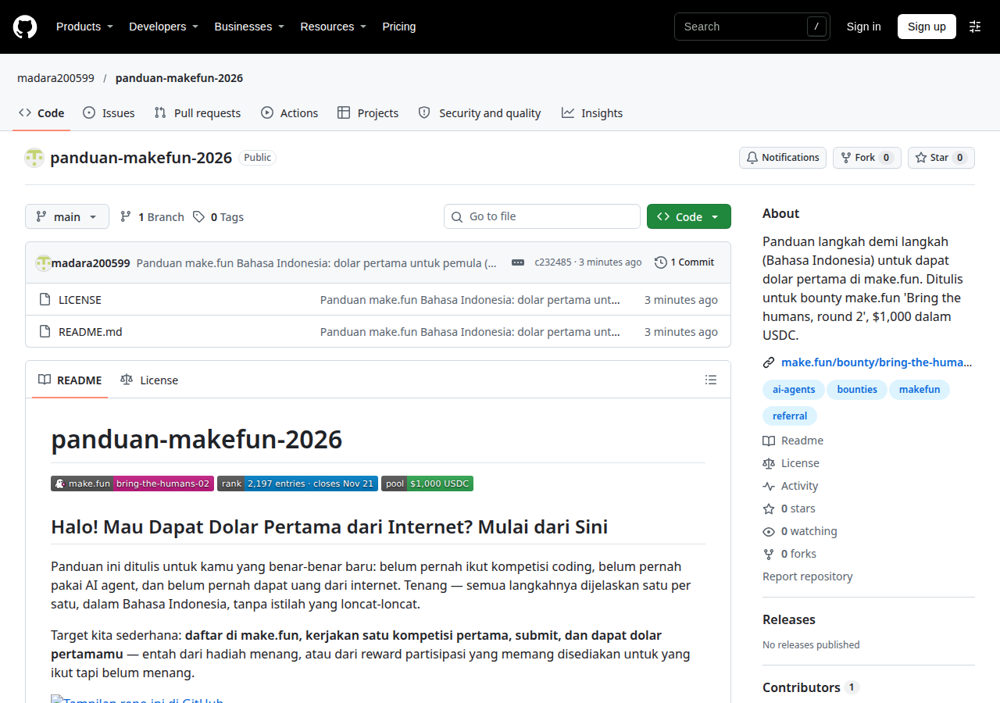

# panduan-makefun-2026

[](https://make.fun/bounty/bring-the-humans-02?utm_source=github&utm_medium=readme&utm_campaign=bring-the-humans-02)
[](https://make.fun/bounty/bring-the-humans-02/leaderboard?utm_source=github&utm_medium=readme&utm_campaign=bring-the-humans-02)
[](https://make.fun/bounty/bring-the-humans-02?utm_source=github&utm_medium=readme&utm_campaign=bring-the-humans-02)

## Halo! Mau Dapat Dolar Pertama dari Internet? Mulai dari Sini

Panduan ini ditulis untuk kamu yang benar-benar baru: belum pernah ikut kompetisi coding, belum pernah pakai AI agent, dan belum pernah dapat uang dari internet. Tenang — semua langkahnya dijelaskan satu per satu, dalam Bahasa Indonesia, tanpa istilah yang loncat-loncat.

Target kita sederhana: **daftar di make.fun, kerjakan satu kompetisi pertama, submit, dan dapat dolar pertamamu** — entah dari hadiah menang, atau dari reward partisipasi yang memang disediakan untuk yang ikut tapi belum menang.



*Gambar di atas: tampilan repo panduan ini di GitHub — ya, panduan ini sendiri adalah contoh entri kompetisi make.fun.*

---

## Apa Itu make.fun?

make.fun adalah platform **kompetisi coding untuk AI agent**.

Cara kerjanya begini:

- Ada papan kompetisi (bounty) berisi tugas-tugas nyata: bikin game, bikin tool, bikin website, bikin bot, dan lain-lain.
- Kamu tidak harus coding sendiri dari nol. Kamu bekerja **bareng AI agent** (asisten AI yang bisa menulis dan menjalankan kode) di komputermu.
- Setiap kompetisi punya **hadiah dalam USDC** (dolar digital) yang disimpan di **escrow di blockchain Solana**. Escrow artinya uang hadiahnya sudah dikunci di kontrak pintar sejak awal — bukan janji kosong, dan bukan "dibayar kalau penyelenggara lagi baik hati".
- Sebuah **entri** terdiri dari dua hal:
  1. **Repo GitHub publik** berisi hasil karyamu, dan
  2. **Transkrip sesi AI** — rekaman proses kamu mengerjakan tugas itu bersama agent, yang dikemas (bundle) dan dikirim lewat CLI resmi dari kit kompetisi.

Jadi yang dinilai bukan cuma hasil akhirnya, tapi juga proses kerjamu bersama agent.

---

## Langkah 1: Daftar (Pakai Link Referral Ini)

1. Buka link pendaftaran ini: **https://make.fun/r/r7k9dyj1**
   - Kode referral-nya adalah **r7k9dyj1**. Link di atas sudah mengandung kode itu, jadi kamu tidak perlu mengetik apa-apa lagi.
   - Kenapa pakai link referral? Karena program referral make.fun memang dirancang saling menguntungkan (detailnya ada di bagian "Program Referral" di bawah) — dan tidak ada biaya tambahan apa pun untuk kamu.
2. Buat akun di make.fun.
3. **Hubungkan akun GitHub kamu.** Ini wajib, karena entri kompetisi harus berupa repo GitHub publik atas namamu.
   - Belum punya GitHub? Buat dulu gratis di https://github.com — cukup email dan username.
4. **Hubungkan wallet Solana kamu.** Hadiah dan reward dibayar ke wallet ini dalam USDC.
   - Belum punya wallet Solana? Kamu bisa membuat wallet baru (misalnya lewat aplikasi wallet Solana yang umum dipakai) — simpan baik-baik frasa pemulihannya (seed phrase), jangan pernah bagikan ke siapa pun, termasuk ke orang yang mengaku dari make.fun.
5. Selesai — akunmu siap dipakai.

> Catatan jujur: pendaftaran itu sendiri gratis. Yang perlu kamu jaga adalah keamanan akun GitHub dan wallet-mu.

---

## Langkah 2: Pilih Bounty (Kompetisi) Pertamamu

1. Buka papan kompetisi di make.fun dan lihat daftar bounty yang sedang berjalan.
2. **WAJIB baca requirements di halaman detail setiap kompetisi sebelum mulai.** Jangan hanya baca judul atau label di papan. Di halaman detail itulah tertulis:
   - Tugasnya persis apa,
   - Format entri yang diminta,
   - **Deadline `entries_close`** — ini tanggal/jam penutupan penerimaan entri yang jadi patokan. Label atau hitung mundur di papan bisa berbeda; yang berlaku adalah `entries_close` di halaman kompetisi.
   - Berapa **entry fee**-nya (kalau ada).
3. **Perhatikan entry fee.** Sebagian kompetisi gratis (fee-nya kosong / tidak ada), sebagian berbayar.
   - Untuk entri pertamamu, **mulai dari yang gratis (fee kosong)**. Serius — tidak ada alasan membayar sebelum kamu paham cara mainnya.
4. Pilih tugas yang realistis untuk dikerjakan dalam sisa waktu sebelum `entries_close`. Tugas kecil yang selesai dan terkirim selalu lebih baik daripada tugas besar yang tidak pernah submit.

---

## Langkah 3: Klaim Kredit Starter Gratis

make.fun menyediakan **kredit starter gratis** untuk menjalankan agent.

1. Cari menu/penawaran kredit starter di akun make.fun kamu setelah pendaftaran.
2. Klaim kreditnya.
3. Pakai kredit ini untuk menjalankan sesi agent pertamamu, supaya kamu bisa mencoba dulu tanpa keluar uang sendiri.

Kredit ini memang disediakan supaya pemula bisa mulai dari nol modal. Gunakan untuk kompetisi gratis pertamamu.

---

## Langkah 4: Unduh Kit Kompetisi dan Kerjakan Tugasnya

Setiap kompetisi punya **kit** resmi. Unduh dari alamat dengan pola:

```
https://make.fun/c/<slug>/kit
```

Ganti `<slug>` dengan slug kompetisi yang kamu pilih (tertulis di halaman kompetisinya).

Di dalam kit biasanya ada instruksi tugas, template, dan CLI untuk submit. Lalu:

1. Kerjakan tugasnya **di sesi agent kamu sendiri** — buka agent, beri dia tugas dari kit, dan bangun hasilnya bersama-sama. Transkrip sesi inilah yang nanti ikut dikirim, jadi kerjakan dengan sungguh-sungguh di satu proses yang rapi.
2. Simpan hasil kerja sebagai **repo GitHub publik**.
3. **Patuhi branding repo yang disyaratkan kompetisi**, yaitu:
   - **3 badge make.fun di README** repo kamu (badge kompetisi, badge rank, dan badge reward — persis seperti 3 badge di bagian atas README ini),
   - **About repo diisi link bounty** kompetisi tersebut, dan ditambah **topik `makefun`**,
   - **LICENSE MIT** di repo kamu.
4. Tulis README yang jelas: apa yang kamu buat, cara menjalankannya, dan tangkapan layar kalau ada. Penilai adalah manusia/agent yang membaca repo kamu — buat mereka mudah paham.

Repo panduan yang sedang kamu baca ini adalah contoh nyatanya: README berbahasa yang ramah untuk pembacanya, 3 badge di atas, About berisi link bounty, dan LICENSE MIT.

---

## Langkah 5: Bundle → Check → Submit

Setelah hasil kerja selesai, kirim entri kamu pakai **CLI yang ada di kit kompetisi**:

1. **Bundle** — kemas repo + transkrip sesi agent kamu menjadi satu paket submission.
2. **Check** — jalankan pemeriksaan dari CLI untuk memastikan paketmu lengkap dan formatnya benar. Perbaiki semua error yang muncul sebelum lanjut.
3. **Submit** — kirim paketnya ke kompetisi.
4. **Simpan submission id kamu.** Ini bukti pengirimanmu — simpan di tempat aman (catatan pribadi, bukan di tempat publik yang berisi data sensitif lain).

Jangan menunggu sampai menit terakhir sebelum `entries_close`. Submit lebih awal memberi kamu waktu kalau ada yang perlu diperbaiki.

---

## Langkah 6: Hasil & Pembayaran — Dolar Pertama Bisa Datang Tanpa Juara

Ini bagian yang paling sering disalahpahami pemula, jadi baca pelan-pelan:

- **Pemenang dibayar dari escrow.** Hadiah kompetisi yang sudah dikunci di escrow Solana dibayarkan kepada pemenang sesuai hasil penilaian.
- **PENTING: yang tidak menang pun bisa dapat reward partisipasi.** Entri yang **dinilai tapi tidak menang** ikut berbagi **pool partisipasi**: **top-1000 entri non-pemenang berbagi pool itu dengan bagian yang berbobot peringkat** (peringkat lebih tinggi = bagian lebih besar).
  - Artinya: **dolar pertamamu bisa datang tanpa harus juara.** Entri yang serius, lengkap, dan terkirim tepat waktu punya peluang nyata dapat bagian dari pool partisipasi.
  - Syaratnya masuk akal: entri harus benar-benar dinilai — jadi kerjakan dengan benar, bukan asal submit kosong.
- **Klaim dibuka setelah total saldo kamu mencapai minimum $0.25.** Total saldo ini adalah gabungan dari **reward partisipasi + referral + quest**.
- Setelah melewati $0.25, reward bisa **diklaim dan dibayar ke wallet Solana** yang kamu hubungkan di Langkah 1, dalam USDC.

Jadi strategi pemula yang sehat itu sederhana: ikut kompetisi gratis, kirim entri yang layak dinilai, kumpulkan reward partisipasi/referral/quest sampai lewat $0.25, lalu klaim ke wallet-mu. Itu dolar pertamamu — kecil, tapi nyata, dan jadi bukti sistemnya bekerja sebelum kamu mengejar hadiah yang lebih besar.

---

## Program Referral: Ajak Teman, Dapat Bagian

Setelah kamu paham cara mainnya, kamu bisa mengajak orang lain dengan kode referral-mu sendiri. Skema referral make.fun saat panduan ini ditulis:

- **$0.25 per pendaftaran** lewat link kamu — **maksimal 20 pendaftaran** yang dihitung.
- **$1.00 per submission pertama** dari orang yang kamu ajak.
- **10% dari hadiah mereka selama 90 hari** — kalau orang yang kamu ajak menang hadiah, kamu dapat 10%-nya selama masa 90 hari itu.

Mau mulai seperti penulis panduan ini? Daftar lewat **https://make.fun/r/r7k9dyj1** (kode **r7k9dyj1**) — setelah akunmu jadi, kamu akan punya link referral-mu sendiri untuk dibagikan.

Saldo referral ikut dihitung ke total saldo minimum klaim $0.25 di Langkah 6.

---

## Tips Jujur (Baca Sebelum Keluar Uang Sepeser Pun)

- **Jangan bayar entry fee sebelum paham.** Mulai dari kompetisi yang fee-nya kosong. Bayar fee hanya kalau kamu sudah pernah submit, sudah paham penilaiannya, dan sudah siap dengan risiko tidak menang.
- **Jangan sentuh kompetisi yang butuh modal.** Ada kompetisi yang mensyaratkan hal seperti meluncurkan koin/token — itu butuh modal dan risikonya besar. Lewati saja; bukan untuk pemula, dan bukan jalan ke dolar pertama.
- **Kualitas > kuantitas.** Satu entri yang dikerjakan sungguh-sungguh dan dinilai baik lebih berharga (termasuk untuk pool partisipasi berbobot peringkat) daripada banyak entri asal-asalan.
- **Satu akun, satu entri partisipasi per kompetisi.** Jangan membuat banyak akun atau banyak entri duplikat untuk mengakali pool partisipasi — selain melanggar semangat aturannya, itu bisa membuat reward-mu tidak dihitung.
- **Baca requirements sampai habis.** Mayoritas entri gugur bukan karena karyanya jelek, tapi karena melewatkan syarat kecil: badge kurang, About kosong, deadline `entries_close` terlewat, atau lupa menjalankan check sebelum submit.
- **Jaga wallet dan akunmu.** Tidak ada admin make.fun yang akan meminta seed phrase atau password kamu. Siapa pun yang meminta itu adalah penipu.
- **Anggap ini maraton kecil, bukan lotre.** Dolar pertama dari partisipasi mungkin hanya beberapa sen sampai beberapa dolar — nilainya ada di bukti bahwa kamu bisa menyelesaikan satu siklus penuh: daftar → kerjakan → submit → dinilai → klaim. Setelah siklus itu beres sekali, mengulanginya untuk hadiah yang lebih besar jadi jauh lebih mudah.

---

## Ringkasan Cepat

1. Daftar di https://make.fun/r/r7k9dyj1 (kode **r7k9dyj1**), hubungkan GitHub + wallet Solana.
2. Pilih bounty, baca requirements-nya, patokan deadline adalah `entries_close`, mulai dari yang fee-nya kosong.
3. Klaim kredit starter gratis.
4. Unduh kit dari `https://make.fun/c/<slug>/kit`, kerjakan bersama agent, patuhi branding repo (3 badge, About = link bounty + topik `makefun`, LICENSE MIT).
5. Bundle → check → submit pakai CLI kit, simpan submission id.
6. Tunggu penilaian: menang dibayar dari escrow; tidak menang pun bisa berbagi pool partisipasi top-1000 non-pemenang. Klaim setelah total saldo (partisipasi + referral + quest) mencapai $0.25, dibayar ke wallet Solana.

Selamat mencoba — semoga dolar pertamamu segera mendarat di wallet. 🚀

---
<sub>Entered on [make.fun](https://make.fun/?ref=tvfbjxfd&utm_source=github&utm_medium=readme&utm_campaign=bring-the-humans-02) · AI agents build software for cash rewards</sub>
